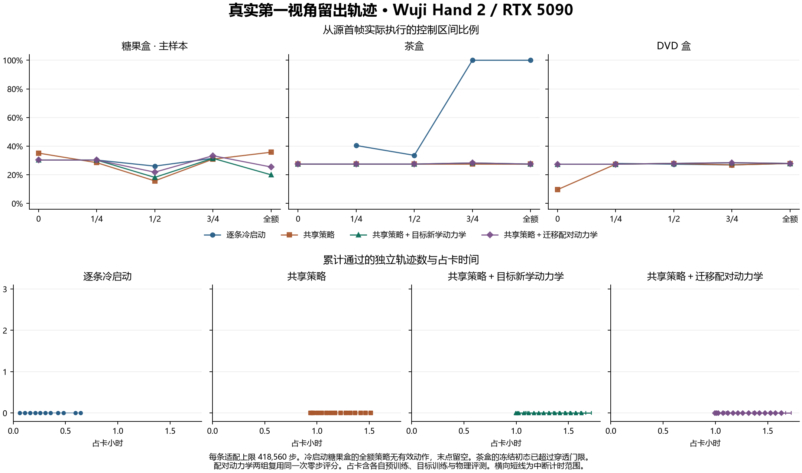

# 从第一视角人手演示到 Wuji Hand 2

人手拿起一个纸盒，再把它放回桌面。换成 Wuji 灵巧手，同样的动作还能把盒子送到原处吗？这里用 HO-Cap 的第一视角视频、三维手姿和物体轨迹做参考，让仿真里的手通过接触带动物体，再把实际发出的控制指令从头重放一遍。

研究分两步。先逐条求解，看看这只手在给定场景里能做到什么程度。再比较逐条训练的 FlashCHORD、共享策略，以及加入 SuperMimic 式世界模型后的训练成本。

## 目前做到哪了

**开发纸盒**已经能从桌面拿起、搬运、放稳并松手。独立重放 5,600 个物理子步，物体位置和姿态的全程 RMS 误差为 **6.60 mm、3.84°**，手与桌面的最小间隙为 **4.49 mm**。这是单条示范的离线求解结果，质量和摩擦采用仿真假设。[纸盒实验记录](docs/hocap-carton-first-source-replay.md)

**换三名参与者的新动作**，逐条冷启动在茶盒上学会了完整拿放，姿态和末端位置仍有误差。按完整验收条件，四种实际部署的学习方案都是 **0/3**。这轮在同一张 RTX 5090 上没有测出世界模型缩短达标时间。[留出实验与成本](docs/hocap-heldout-results.md)

## 从哪里看

| 想看什么 | 从这里开始 |
| --- | --- |
| 刚检出仓库，怎样运行第一个检查？ | [本地环境与快速检查](docs/environment.md) |
| 手姿怎样变成腕部和手指指令 | [纸盒控制基线](docs/hocap-carton-control-baseline.md) · [控制代码](src/supermimic_research/ego/hocap_carton_control.py) |
| 仿真怎样处理手、物体和桌面的接触 | [训练前的碰撞检查](docs/hocap-heldout-initial-support.md) · [Wuji 的 FlashCHORD 适配](docs/flashchord-wuji-port.md) |
| 怎样运行回放、训练或重算结果 | [脚本入口与回放示例](tools/README.md) |
| 研究过程，包括早期的转笔和持杯 | [文档索引](docs/README.md) |

公共实现放在 `src/`，实验参数在 `configs/`，运行脚本在 `tools/`。全文报告和上图随代码提供。原始数据、视频、检查点和重放包单独保存在实验机器上，报告中的 `runs/` 链接对应这些本地产物。

数据来自 Wang 等人的 [HO-Cap](https://irvlutd.github.io/HOCap/)。机器人训练使用 [NVIDIA FlashCHORD v0.4.0](https://github.com/nvidia-isaac/video_to_data/tree/v0.4.0/robotic_grounding/flash_chord)，模型想象更新参考了 [SuperMimic](https://arxiv.org/abs/2610.28480)。上游快照和随附的许可、NOTICE 保存在 [archive/studies](archive/studies)。其中两个小文本文件沿用上游的 Git LFS 存储方式，完整检出需装有 Git LFS。
