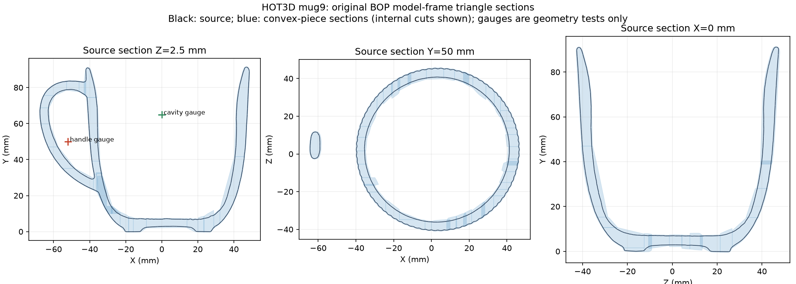

# 杯子复合碰撞原型与原生数值验证

2026-11-08。本轮为已有HOT3D杯子BOP9建立碰撞资产，尚未把它重定向到Hand2。
原始GLB、旧手机任务、数据分区和训练结果保持不变；没有新NN训练或检查点。

## 坐标、源网格与惯性先验

原始GLB的Cup_White节点包含约0.001的缩放。应用一次节点变换后，bounds与同版
models_info在1e-10 m内一致；没有再次乘0.001、重定心或改变BOP模型原点。
源网格17,848顶点、31,606三角面；仅合并精确重合位置后为15,803顶点，全部
三角面的空间坐标保持不变。焊接后无边界边，但有7条非流形边，不能宣称原网格
已成为可靠闭合体或直接用其有向体积估计实际质量。

质量暂定0.25 kg，范围[0.15,0.5] kg。COM与完整惯性张量来自均匀三角面面积
分布的精确二阶矩，属于表面薄壳先验；不是实测材料密度或质量标定。
COM在原模型坐标中约为[0.15950,46.00885,2.45171] mm。惯性正定并满足三角不等式，
不随凸分块数量变化，碰撞geom density=0，避免分块重叠重复计质量。
手接触摩擦先验范围[0.3,1.0]，object geom名义滑动系数0.7；桌面显式pair为0.6。

## 分解、反例与修订

采用独立`.venv-assets`中的CoACD1.0.14 CPU后端；旧研究环境没有安装或修改
CoACD。使用real_metric模式的1 mm凹度目标和auto预处理，源视觉表面保留原样。
该API没有暴露预处理后的表面，因此不能单独认证修补误差。
模式含义见[官方说明](https://github.com/SarahWeiii/CoACD)，版本来源见
[官方PyPI发布](https://pypi.org/project/coacd/1.0.14/)。

|配置|结果|保留的限制|
|---|---|---|
|首个较重树搜索、64块上限|240 s达到截止时间，被父进程终止|无完成资产，失败日志与执行源码保留|
|减少树搜索、64块上限|约228 s完成|后端提示块数限制导致凹度目标未达到|
|同一较轻搜索、128块上限|约238 s完成|仍有块数限制警告，不能声称达到全局1 mm误差|

首个64块数值原型仅7/9通过：采样外表面最大偏差3.252 mm，超过事前3 mm门；
100 mm落体在20 ms接触时间常数下产生约9.7 mm最大穿透。没有放宽原门。

同一64块几何、质量、惯量、摩擦、初态和求解器的匹配对照，仅改变接触时间常数：

|时间常数|粗dt最大穿透|细dt最大穿透|
|---:|---:|---:|
|20 ms|9.6566 mm|9.7307 mm|
|2 ms|0.7863 mm|0.8570 mm|

这是数值接触柔度的受控检查，不是实测材料识别。2 ms大于两个步长下的2dt；
新128块原型采用该显式先验，旧手机的物理参数不变。与Hand2组合时仍须核对实际
contact pair参数，不能把单个geom声明直接当成最终混合后的接触设置。

## 最终128块原型

保持事前定义的探针与验收门，9/9项通过：

- 1024个确定性源顶点/三角面质心样本均在凸体并集中；这不是全表面覆盖证明。
- 1024个采样暴露分块面质心到源表面的最大距离2.183 mm、RMS0.435 mm。
  这是有限采样结果，不是全局Hausdorff上界或真实物理误差。
- 杯把与杯腔的1 mm主通道同时通过源表面、凸体并集分离下界和原生探针检查。
  3 mm通道也有正数值余量；5 mm杯把连续通道仍不可认证，不能宣称任意手指可穿入。
- 原生3 mm表面正控探针均有接触；共执行162次独立静态探针forward。
- 编译后几何坐标与导出的分块顶点在1e-7 m内一致，MJB保存/恢复指定数组字节一致。
- 两个原步长的2 s孤立杯子/桌面落体均完成：19,200积分步，最大穿透约
  0.7866/0.8584 mm，无警告，末段桌面法向载荷约2.4525 N，与先验重量相符。



黑线为源三角面截面，蓝色为凸分块截面（含内部切割边）。这是数据图，不是机器人
策略效果。凸体并集与独立探针共同检查很必要：对称完全包含的原生凸碰撞fixture
曾出现零contact，不能把“原生没有接触”单独当成空腔证明。

## 复核、资产入口与范围

在原研究解释器中重新加载最终MJB，独立从保存的POST位置/四元数/速度重建COM与
速度、整数时钟、单位四元数、末段载荷和双dt终点，复核10/10。终点COM差
18.95 um，转角差约0.0399度。复核没有重跑积分，也未从紧凑trace独立重算
原生最大穿透；该值依赖执行时的接触读取及保留源码。

当前是孤立物体资产：nq7/nv6/nu0，**没有Hand2、Actor、世界模型或重定向轨迹**。
原生落体不是原两秒持握门通过；全部物理参数仍需校准与鲁棒性检查。
源RGB/注释窗口与手指实际接触还未进入此场景，不能写成真实ego重定向已完成。

资产索引位于`runs/mug_asset_validation_v2/artifacts.toml`，8个条目均通过SHA验证。
MJB、OBJ、NPZ和原始GLB在Git外，由索引定位；物理先验与框架契约单独保存。
示例（仓库根目录，检查不启动训练）：

```powershell
& ..\dex-supermimic-research\.venv\Scripts\python.exe scripts\research.py --artifacts runs\mug_asset_validation_v2\artifacts.toml artifacts --verify
```

全套75个测试通过。旧runtime/learning/Dex/CHORD、配置、archive与9b38f97一致。
新代码在公共`assets`模块，完整依赖锁与失败/成功记录见
[证据映射](../provenance/mug_asset/summary.json)。下一步为[方案v0.42](research-plan-v0.42.md)。
