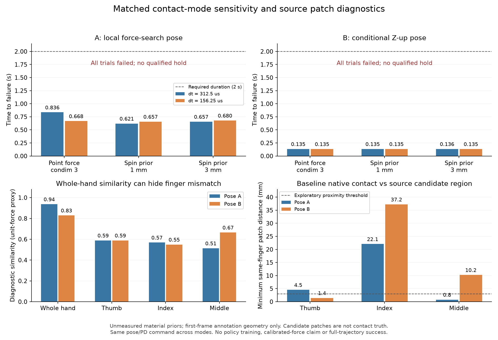

# 杯子接触模型对照与分指接触区域诊断

2026-11-08。两个既有静态合格姿态、三种接触模型和两个积分步长的12个无辅助
案例全部失败。新增的是接触力偶/EFC验证与源候选区域诊断，没有神经训练、
检查点或策略收益。统一仓库是唯一开发入口；原手机学习代码和历史结果未改动。

## 接触模式对照

MuJoCo的condim3提供法向与切向接触力，condim4增加绕法向的直接扭转力偶；
扭转摩擦系数具有长度单位。[官方接触模型说明](https://mujoco.readthedocs.io/en/stable/computation/index.html#contact)

从原模型分别加载并保存三份MJB：原condim3，以及扭转系数为0.001和0.003 m的
condim4变体。数值是**未经标定的探索先验**，不等于测得的指腹半径，也不声称
该区间已由实物几何证明。仅128块物体组件与9个指定三指远端几何的1152个显式
pair改变`pair_dim`和扭转摩擦列。机器人根、关节、几何、质量/惯量、增益、
切向摩擦、接触时间、桌面及其他pair均不变，原未启用的0.005项不被自动激活。

姿态A取此前局部受力搜索seed00；姿态B取条件Z-up分支的50 µm预紧姿态。
每个姿态的初始q、零速度和恒定合法PD目标在三种模式间完全相同，不再优化。
在积分变体之前，A的原模式双dt全部trace数组与历史原件逐字节一致。
静态几何合格记录继续适用，是因为模型几何与q字节不变，不代表动态连续无碰撞。

|同一姿态、同一命令|A粗dt / 细dt终止(s)|B粗dt / 细dt终止(s)|完整持握|
|---|---:|---:|---|
|原点接触condim3|0.835625 / 0.667969|0.135313 / 0.134688|失败|
|扭转先验1 mm|0.620938 / 0.657500|0.135313 / 0.135313|失败|
|扭转先验3 mm|0.656875 / 0.679531|0.135625 / 0.134688|失败|

两个dt为312.5/156.25 µs。A原粗dt因COM偏移50 mm终止，其余A因转角45°；
B均因COM偏移50 mm终止。共23,485次实际积分，0/6双dt组合通过。未完成2秒的
轨迹不能用部分端点证明步长一致或持握；增加扭转摩擦在这两个固定姿态上没有
解决问题，也没有证明其他构型、控制或材料全局无效。

在A粗dt的冻结接触集，含完整合法PD范围及乐观干摩擦盒的数值最大静态支持
从4.3193 N变为4.3721/4.4705 N；固定命令LP从不可行变为可行，但真实原生
积分仍失败。B三种模式均未找到六维重力/力矩平衡。静态射线系数没有施加给
仿真器，这些LP不包含柔度、接触切换和动态可达性，也不独立认证不可行或最优。

## 力偶、坐标与保存复核

新`mechanics/contact_modes.py`同时构造世界力、移动COM力矩和手部负载列。
直接力偶经接触坐标旋转后加入，点力另加力臂叉积；手部角Jacobian同样计入力偶。
所有EFC单位查询只读，不写`efc_force`或外力。含偏心COM和两物体相反作用的
原生测试验证了符号和力矩平移。

保存复核重新加载独立MJB，验证只有允许的1152个pair字段改变；从原生约束
Jacobian的224个单位列复核扳手与手部负载，并复算28份可行原始解。12个失败
trace共156/156检查通过，包括PRE/POST连续性、COM、每10 ms原始接触聚合、
端点原生速度、限位和失败门。检查通过表示读取/约定一致，不是物理成功证书。
全库99项测试通过。

## 源区域候选与整体指标的盲点

这里只使用clip001884第47帧的现成手/物体注释与源扫描，不是独立RGB重建。
按3 mm皮肤—扫描距离、BODY坐标x<-45 mm和三个手指的主蒙皮组筛得30个候选点
（拇指8、食指8、中指14）。源三角法线用近似128块凸体的±3 mm探针交叉核对，
30个均相符；这不能证明全局实体定向、源网格水密或真实接触。

其中9点的局部面法向偏移为负，范围-1.751至+2.966 mm。该符号不是全局SDF，
不能直接认定人体穿透。另保留去掉负偏移的21点敏感性分支（3/6/12），而不是
删除不利数据后只报告较好的结果。所有`contact_ground_truth_known`仍为false。

在BODY轴下先减COM一次，复用未改动的CHORD unit-force支持核：512个固定六维
单位方向、µ=0.7先验、8边锥、力矩尺度0.1 m；用现有容差分数作**诊断相似度**。
这与原生单位法向棱锥的静态力预算不同，既不估计真实力，也不是已验证的奖励。

|原condim3姿态|整手相似度|拇/食/中指相似度|同指候选区最近距离(mm)|
|---|---:|---|---|
|A|0.9368|0.5891 / 0.5691 / 0.5137|4.54 / 22.07 / 0.79|
|B|0.8297|0.5892 / 0.5494 / 0.6654|1.44 / 37.24 / 10.24|

B有两个中指接触，表中列最小距离，另一点18.59 mm。A食指最近源点的法线点积
为-0.958，即方向相反；不能把“所有源点中的最大法线点积”与另一源点的最小
距离拼成一个有效匹配。新分指匹配要求同一对点同时满足距离≤3 mm、法线点积
≥0.5，并保留未知值。30点分支下A只有中指匹配、B只有拇指；21点分支B拇指也
不匹配。阈值是探索性诊断，不是接触标签或真机验收条件。

整体相似度高不能保证指别、接触位置或静态力预算正确；上述两个案例也不足以
概括整个CHORD方法。NumPy逐点/逐射线独立复核9/9通过，描述子误差4.44e-16，
分数误差1.11e-16，确认观察不是Torch广播、COM重复平移或匹配聚合的实现差异。
近似凸体定向决定被复用，实际重力、人体受力和接触真值仍未知。



## 复现和后续

在统一仓库根目录，用现有Hand2 Python运行，输出必须是`runs/`下的新目录：

```powershell
& ..\dex-supermimic-research\.venv\Scripts\python.exe -X utf8 tools/evaluate_mug_contact_modes.py --reference runs/right_mug_frames_v4 --output runs/mug_contact_modes_NEW
& ..\dex-supermimic-research\.venv\Scripts\python.exe -X utf8 tools/review_mug_contact_modes.py --run runs/mug_contact_modes_v1 --reference runs/right_mug_frames_v4 --output runs/mug_modes_review_NEW
& ..\dex-supermimic-research\.venv\Scripts\python.exe -X utf8 tools/inspect_mug_source_patches.py --reference runs/right_mug_frames_v4 --modes runs/mug_contact_modes_v1 --output runs/mug_patches_NEW
& ..\dex-supermimic-research\.venv\Scripts\python.exe -X utf8 tools/review_mug_source_patches.py --run runs/mug_source_patches_v2 --modes runs/mug_contact_modes_v1 --reference runs/right_mug_frames_v4 --output runs/mug_patch_review_NEW
```

这些工具针对本次已固定的姿态和资产；不是任意任务的训练/通过脚本。v1区域工具
只保存整体描述子，v2补充分指输出；v1原报告及精确执行源码仍保留。JSON证据、
意图、版本、来源哈希、图和测试记录见`provenance/mug_contact_modes/summary.json`；
大MJB/NPZ仍在忽略的`runs/`内，通过原始pin定位。

下一步是分指候选区域/法线条件化的有界提议，并同时检查实际手指实体能否放入
杯柄以及六维/驱动支持。人体与机器人形态不同，源区域只提供有不确定性的意图；
若不可达要明确报告偏离，不能把它硬称作真实标签。之后仍须完整双dt无辅助验收、
61帧参考与非均匀时间重建、独立RGB及WM/A1/A2验证。详见方案v0.46。
