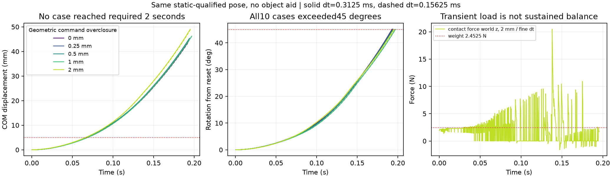

# 杯柄适配：静态碰撞通过，原生持握仍失败

2026-11-08。上轮`edc87d0`完成61帧人体注释FK、掌部坐标与新Hand2场景，属于进展。
本轮进一步做了条件重力核对、实际碰撞体约束IK、接触聚合和双步长原生持握。
得到一个静态几何合格的三指姿态，但10个原生案例全部失败，不能启动基于此抓握
“已可行”的学习对照。Goal保持active；没有新增神经训练或检查点。

## 重力与源接触意图的边界

固定官方HOT3D代码版本`146b34afef8c1a32adeef7e981c070109f225c87`。其查看器明确
将Aria设为`RIGHT_HAND_Z_UP`、Quest设为Y-up，见[官方同版实现](https://github.com/facebookresearch/hot3d/blob/146b34afef8c1a32adeef7e981c070109f225c87/hot3d/Hot3DVisualizer.py#L115)。
这支持Aria的世界向上约定，**不等于本片段的实测重力向量**，也没有证明clips制作
过程未重定义世界朝向。没有因为看到了Aria MPS的一般说明，就把HOT3D对象真值
直接认作MPS世界；没有根据杯子朝向猜测重力。

条件地采用源世界[0,0,-9.81]，经上轮每帧掌部对齐旋转，首帧在机器人世界变为
[5.8228,-6.8477,3.9294] m/s²；与仿真[0,0,-9.81]的方向差范围111.908–117.768°。
所以现有掌部几何映射不保持重力条件，不能直接搬运人体接触力/重力扳手标签。
上轮冻结binding的源重力UNKNOWN字段保留，新的条件诊断单独记录。

实际人体皮肤最近点也不等于指尖landmark。首帧拇/食/中指最近皮肤点与各自指尖
标记相距12.9/23.8/9.6 mm；最接近皮肤点的主LBS骨架分别为拇指末段、食指
中/末段、中指末段。三指源表面接近仅是意图候选，不是真实接触或力监督。

## 从指尖IK到实际碰撞体

场景、杯子姿态、物理参数、机器人根和尺度均保持上轮值。先以5个源指尖landmark
的掌部映射位置做有界20关节IK，三指权重1、无名/小指0.25，位置尺度10 mm，
弱正则0.003，三个事前固定种子各最多300次残差调用。使用MuJoCo原生运动学和
site Jacobian；普通包导入，没有运行旧目录Python。

三个种子都得到几乎相同的解：指尖误差最大约0.264微米，但每个都有15对手—杯
相交、7对手部自相交。最深组件相交约8.038 mm。**指尖误差小不能证明指腹能
放进去**；这些结果完整保留，不能当成成功重定向。

之后用实际原生geom距离和见证点Jacobian作提议，添加碰撞处罚和三指指腹接近
项。指尖尺度改为20 mm，碰撞尺度0.5 mm，非意图/自碰/手桌目标分离0.2 mm；
意图区域限拇/食/中指的link3、link4和tip_sensor，事前声明。两个种子各上限160
次残差和45 s。原生距离仅用于搜索：它不是凹物体SDF，也不能单独认证包容关系。
零距离见证方向的显式启发式有计数，未被称为物理梯度。

独立资格检查逐个遍历128个凸块与21个手geom及桌面的2816对，再检查189对
自碰和21对手桌，共3026对。复用既有Qhull/支持见证查询；未知查询不通过。
意图区域使用每组件[-100,+200]微米带，其他区域分离≥0。每个三指组至少一对
位于接近带。组件纯平移裕度不等于完整凹体的有符号距离或联合退出深度。

|阶段|候选数|结果|
|---|---:|---|
|仅指尖IK|3|全部碰撞失败|
|原生距离约束提议|2|所有碰撞检查均清除，但各缺少一指进入200微米接近带|
|局部独立几何恢复|2|候选0全部通过；候选1出现一对约123微米自碰，失败|

局部恢复只修改最初缺失的指组，在独立选定组件对上做1e-5 rad中心差分；目标
50微米、容差10微米、最多8次、单步L∞≤0.02 rad。候选0只改变约0.001318 rad
即通过3026对检查，未知0。候选1失败未删去或放宽自碰门。全部只是静态姿态；
没有把机器人手指缩小或把杯柄扩大，也没有改变固定腕。

## 组件接触力与移动COM力矩

新增公共`CompoundContacts`：每条原生contact只读一次`mj_contactForce`，根据
物体在geom1/geom2中的位置确定符号；contact.frame转到world后求和。力矩包括
原生接触力偶，以及`(contact_position - object_COM) × force`；再转入物体BODY轴。
128块属于同一个BODY/惯性，不重复计质量，也不因同指接触多个组件而重复计一条
contact。多个真实原生接触仍逐项求和，不能错误地每指只留一个点或平均掉力。

两个解析fixture验证正负号反转和双组件单刚体的COM偏移力矩，并与MuJoCo的
`cfrc_ext`原生独立求和比较。一个实际手部平滑距离对的见证点Jacobian通过中心
差分，但这不认证所有切换/包容状态，更不是WM物理梯度验证。

## 无物体辅助的持握实验

使用唯一静态合格候选0，杯子初态和qpos完全相同。沿三指选定组件间隙的几何
差分方向构造5组恒定**合法绝对PD位置目标**：过闭合参数0/0.25/0.5/1/2 mm。
参数只用于构造目标，不是强制施加的指尖位移；最大关节目标改变量约0.03004 rad。
这不是原手机Actor/EMA残差控制器，也不是策略对照或视频参考播放。

每组分别用dt=0.3125/0.15625 ms，计划2 s，共上限96,000积分步，实际9,343步。
无mocap、等式、重力补偿、外加广义力或物体力；机器人原增益、力矩限幅、限位、
碰撞资产和物体惯性保留。每案例仅允许改变dt，完整模型摘要前后校验。

使用原手机相同数值门：2 s、末端COM≤5 mm、转角≤5°、尾部速度≤0.01 m/s和
0.2 rad/s、三组各>0.1 N覆盖率≥95%、原生穿透≤2 mm、自碰≤0.2 mm等。
**意图接触区域已事前改为杯子三指远端9个geom**，语义不同于旧手机3个tip_sensor，
因此不能称为与旧手机任务同条件的算法收益。报告保留旧数值门键名以追踪来源。

|过闭合参数|粗dt终止时刻|细dt终止时刻|结果|
|---:|---:|---:|---|
|0 mm|0.192813 s|0.192969 s|两者转角>45°|
|0.25 mm|0.193438 s|0.193750 s|同上|
|0.5 mm|0.194063 s|0.194375 s|同上|
|1 mm|0.196875 s|0.197031 s|同上|
|2 mm|0.195000 s|0.195625 s|同上|

10/10失败，0/5双步长合格。末端COM漂移43.9–49.1 mm，全部没有进入1.5–2 s
尾部窗口；不能把这些部分时长端点接近称为2秒步长一致性。原生最大穿透约
0.065–0.103 mm、自碰0、非意图力0、警告0，失败主要体现为物体移动和旋转。

三指存在明显瞬态接触力。例如粗dt下食指峰值随参数可达约16–21 N，但世界Z向
接触力的全程时间均值仅约1.84–1.92 N，低于2.4525 N重力。更大峰值并没有带来
持续受力/力矩平衡。这里只观察这5个目标，不是“加力无效”或全局动态无解证明。

每个积分步保存PRE受力聚合和POST状态；10 ms样本保存全部原始contacts并与
`mj_rnePostConstraint`外力比较，最大绝对差1.78e-15。独立保存复核140/140项通过，
包括PRE/POST连续性、原始目标、时间、所有POST COM、10个末态原生COM速度、
采样BODY力矩和canonical法向力。复核不独立证明未保存的外加力数组或未采样
contacts明细；无辅助断言来自执行源码的逐步检查，连续理想凸体碰撞也没有逐步重算。

## 保存与下一步

全库88项测试通过。实现只增加到统一仓库的`mechanics`和工具入口；冻结手机
runtime/learning、旧数据角色、旧模型和所有历史结果不改。大MJB/NPZ/完整几何
日志仍在ignored runs，保留的小报告、静态合格几何、图、来源SHA和条件重力源码
在`provenance/mug_grasp`。没有GPU学习或新检查点，首健康检查点暂停约定未触发。

下一步先检查实际接触配置的重力/力矩支持与驱动约束，再联合调整合法初态、PD
目标或杯子放置。若采用保持重力的物体放置，必须明确放弃哪部分严格掌部对齐，
不能暗改腕或源轨迹。通过无辅助双步长完整持握后，才推进61帧时钟/观测契约、
新TRAIN/独立heldout及匹配预算学习。完整原目标仍保留，见[方案v0.44](research-plan-v0.44.md)。
