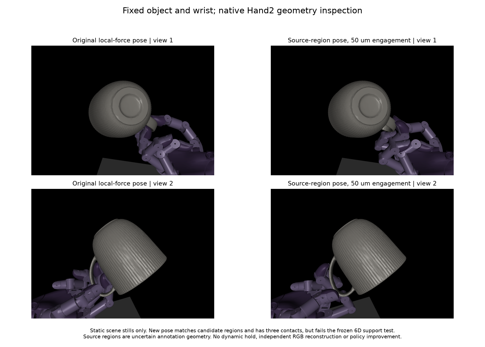

# 分指源区域提议、全手避碰与支撑方向诊断

2026-11-08。上一轮`92a0f18`验证了接触模式与源候选区域诊断，属于进展。
本轮实现材料点/法线条件化提议、全手联合避碰和小幅接触激活。得到一个静态几何
合格姿态及三个真实三指接触版本，均匹配源候选区域；但六维静态支持仍不成立。
没有新神经训练、检查点、原生动态持握积分或成功声明，Goal保持active。

## 从“指尖到位置”改成“表面点与法线到区域”

使用原点接触模型及此前局部受力搜索seed00的物体位姿，机器人根和物体均固定。
从三个手指各3个远端碰撞几何，取初态原生组件距离的手侧端点，并恢复手实体的
凸包支持面或胶囊径向表面点/外法线。端点向真实手表面的修正不超过20 µm。
选中的材料点和法线在该次局部搜索中随手指刚体运动，不随最近接触点漂移。

对上一轮30点全候选和21点非负局部偏移分支分别求解。每指4关节、3种材料锚点、
2个合法起点，共36次局部搜索；位置尺度3 mm、法线向量尺度0.5、离源扫描外侧
50 µm，使用原生点/角Jacobian。34/36个结果满足探索性3 mm/法线点积≥0.5门。
这只是指定材料点的局部可达性，不是接触、全手可达或全局搜索证明。

各分支采用最低代价拇/中指结果，并枚举3个食指锚点，形成6个全手组合。6个均
出现物体或手指自碰，最深约7.8–9.6 mm；部分原生接触已匹配源候选区域，但
不能因此接受有穿透的抓握。完整逐对审查保留，未知从不当作通过。

## 全手联合修正

每个分支取失败对总数最少的组合，联合调整20关节。复用公共`ContactAwareIK`
的物体、自碰、桌面和近接触处罚行，去掉其指尖拟合行，加入上述材料点/法线
目标及弱正则。无新副本、无机器人根/物体位姿优化；原模型、摩擦与质量保持。
每个局部搜索最多160次残差、30秒，实际完整残差次数为57和32。

|分支|全手几何|材料点距源候选区，拇/食/中(mm)|对应法线点积|原生承载|
|---|---|---|---|---|
|全30点|通过|0.644 / 0.370 / 0.371|0.948 / 0.987 / 0.987|三指均0 N|
|非负偏移21点|失败，1处约0.209 mm组件侵入|4.816 / 1.707 / 0.444|0.846 / 0.909 / 0.973|缺中指，拇指偏区|

21点分支的结果不被丢弃或升级成合格。全30点分支的无碰撞和材料点匹配也不等于
实际接触：原生forward显示三个手指均未承载。50 µm外侧目标与源扫描/近似组件
差异都会影响原生接触，必须继续单独检查。

## 激活接触后，仍缺力矩支持

从全30点的合格姿态出发，只调整三指各4个关节，用指定组件对的精确距离割线
分别接近-20/-50/-75 µm；每次步长≤0.02 rad，最多8步/指，硬限位和合法PD目标
不投影、不放宽。最终重新检查全部组件、自碰和桌面。

|组件目标侵入|原生法向力，拇/食/中(N)|全手几何|实际接触区域及法线|只平衡力 / 六维平衡|
|---|---|---|---|---|
|20 µm|0.787 / 1.305 / 0.191|通过|三指匹配|可行 / 不可行|
|50 µm|1.330 / 1.792 / 0.534|通过|三指匹配|可行 / 不可行|
|75 µm|1.803 / 2.184 / 0.671|通过|三指匹配|可行 / 不可行|

这里只验证与不确定源候选区域的匹配；真实源接触标签仍未知。三个版本原生
接触均存在，但未找到抵消重力且绕移动COM力矩为零的非负射线组合，不能把
法向力增大当作承载成功。没有给仿真施加LP射线、附加物体力或虚拟控制。

新`wrench_separation.py`进一步寻找并直接检查数值分离证据：对实际原生棱锥列
W和重力平衡目标t，存在y使`W.T @ y >= -1e-9`且`t @ y = -1`（误差≤1e-9）。
计算时力矩除以0.1 m改善尺度，再把对偶变量变换回N/N·m对应单位。三个版本均
得到这样的证据。它分离的是**当前冻结接触射线锥**，并不证明动态、全局或其他
接触构型无解；也不是施加的运动、真实人体力或物理策略梯度。解不唯一。
实现把自由对偶变量拆成非负变量，以SciPy HiGHS求解，并自行复算上述不等式，
而非只接受求解器状态。[官方线性约束接口](https://docs.scipy.org/doc/scipy/reference/optimize.linprog-highs.html)

代表性尺度化对偶方向约为[-0.508,0,-0.408,0,-0.940,0]，表明需要联合考虑
力与绕Y轴力矩，不能只补竖直法向力。后续以完整分离不等式评价新接触方向，
不能把某个对偶分量单独解释成唯一缺失轴或真机诊断。

图是原生MuJoCo场景静帧，不是动态持握或视频重定向成功演示。物体使用原BODY
坐标、原机器人根与本次固定的物体变体位姿；未声称恢复源序列重力或完整轨迹。

## 复核、计数更正与范围

保存复核重建36个材料点/法线指标，重新执行全部11份完整几何审查，并直接用
44个原生EFC单位列检查保存的扳手、手部负载、可行原始解和3份分离不等式。
全库104项测试通过。几何重算复用公共凸体实现，因此是保存一致性复核；原生
EFC/分离不等式的重建不依赖手算扳手列，不是全局碰撞谓词或最优性认证。

本次纠正了此前文字中的一处计数：实际为2816个物体对、189个自碰对、**20个**
手—桌面对，共**3025对**。固定手根与桌面的同焊接体过滤规则排除了额外一对。
以前部分说明/intent写3026或手—桌21，对实际保存的逐对列表和结果没有改动。
新复核按当前编译规则计数，旧证据保留，此处作为明确勘误。

复核工具第一次因上述错误计数中止，第二次在完成11份重算后因NumPy布尔的
JSON序列化失败。两次精确执行源码和终止记录均保留，最终版本重新执行并验证。
主实验11次完整几何检查，三次复核尝试合计23次；没有将重复复核隐去或计成
额外物理试验。预紧日志的`queries`是在最后三个距离读回前取值，实际每个版本
还包含3次最终距离查询；该字段不被拿来报告总性能开销。

本轮没有触发动态积分的前置门，因此不是新增“动态失败案例”，更不是新的
训练收益。源信息仍来自现成注释和扫描；30/21点都不是独立RGB重建或接触真值，
源重力、质量/摩擦等实测参数、61帧完整重定向及WM/A1/A2仍未完成。

代码、报告、操作失败及测试记录见`provenance/mug_patch_proposals/summary.json`。
复现顺序为`propose_mug_source_patches.py`、`refine_mug_source_patches.py`、
`engage_mug_source_patches.py`、`diagnose_mug_patch_support.py`和
`review_mug_patch_proposals.py`；每个工具`--help`给出显式输入和新输出路径。
工具针对本次固定资产，不能把任意任务通过门简化成只检查退出码。
