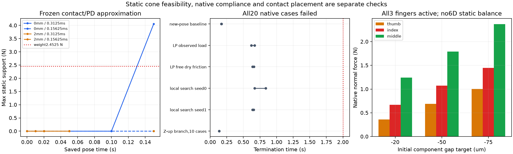

# 杯子支持能力诊断与条件重力放置

2026-11-08。上轮`083c179`得到静态合格姿态但10个原生持握失败，属于进展。
本轮把诊断推进到原生约束Jacobian、六维静态支持、真实PD命令、局部初态搜索
和条件重力放置。新增20个无辅助动态案例全部失败；没有新增神经训练或检查点，
Goal保持active。原手机任务、旧模型、数据角色和上轮结果均保留。

## 先检查力矩，再讨论预紧或学习

从上轮0和2 mm命令、两个dt的轨迹中固定选取0/10/20/50/100/150 ms的PRE姿态，
共24个。每个姿态保留原qpos和命令，速度重置为0后原生forward，作为**准静态
重投影**，不冒充原动态受力快照。仅使用实际激活、属于预定三指区域的condim3
物体接触；无桌面、非意图或外力帮助。

支持列由实际接触坐标、摩擦参数、物体COM和手部点Jacobian构造。每个接触使用
原生棱锥的4条单位法向生成射线；同时保留世界力、移动COM力矩和所需关节力矩。
固定增益仿射PD、实际执行器/关节力矩饱和以及合法命令范围决定驱动盒约束。
另比较冻结其他约束负载和乐观的完整干摩擦盒；均不包含原生柔度或接触演化。

- 24个姿态中，10个数值LP可以只平衡重力的3维力，只有1个能同时平衡6维力与力矩。
- 初始姿态只有食指、中指两个实际激活接触；几何“接近带合格”不等于三指已承载。
  它可满足力平衡，却未通过力矩平衡。不能据此证明该物体或任务全局动态无解。
- 唯一六维可行点是0 mm命令、粗dt轨迹的150 ms姿态。数值最大支持重量在局部
  命令±0.05 rad时为1.262 N；完整合法命令范围为4.056 N，放开干摩擦盒为4.317 N，
  对比杯子重力2.4525 N。这只是冻结几何的LP结果，不是原生可达力或动态保证。
- 共192次LP尝试，实际176次调用HiGHS；两处空接触集在求解前返回。v1曾将尝试数
  写作`LP_calls`，其执行源码保留；v2明确分开两类计数，原数值输入不被改写。

独立复核没有复用手算支持列：用原生`mj_mulJacTVec`对EFC约束的单位向量作只读
查询，从原生广义力恢复物体世界力和BODY轴的root力矩，再把力矩平移至COM。
172列查询的最大扳手差3.89e-16，手部负载列差2.78e-17；79份已找到的LP原始解
通过力/力矩/力矩盒残差复核。单位向量从未写入`efc_force`或施加到仿真。
这些检查不独立认证求解器的不可行性/最优性，也不认证视频接触力或WM梯度。

## 把解析命令真正交给机器人

选定上述六维可行姿态，重新通过全部3026对几何检查，并以零速度建立新初态。
它相对最初杯子BODY原点移动约[-26.853,-0.426,-6.432] mm，旋转约25.66°，是
**不同的初态变体**，不是原任务恢复或源视频修正完成。手关节相对上轮静态合格
姿态最多约0.03911 rad；运行报告的`hand_q20_max_change_rad=1.4644`则以最早
未拟合的q=0组装姿态为参照，两者不能混淆。

通过PD仿射映射把两个完整命令域LP的假设关节力矩转换成合法位置命令，最大
目标变化约0.126/0.128 rad。只施加这些PD命令；绝不施加假设接触射线或力矩。
因此这也不是旧手机±0.05 rad残差策略的同预算算法对照。

|同一新姿态的控制目标|粗dt终止|细dt终止|原生结果|
|---|---:|---:|---|
|原命令|0.16875 s|0.16891 s|转角超45°|
|冻结其他负载的LP命令|0.61906 s|0.66906 s|转角超45°|
|乐观干摩擦LP命令|0.63844 s|0.65906 s|转角超45°|

终止时刻延后仍不是持握成功；没有案例达到2秒，不能把部分端点视为步长一致。
瞬态单指力甚至达到百牛量级，而持续跟踪仍失败，说明不能只用法向力峰值作目标。
未标定接触参数、接触切换与局部构型仍须进一步检查。

## 局部原生平衡搜索

从两个LP目标出发，联合调整20个初始关节、杯子小幅位姿和20个PD命令，总46维。
事前轴向半径分别为0.03 rad、2 mm、0.04 rad和0.3 rad，并与原硬限位求交。
对零速度原生广义合力作有限差分搜索，保留真实三指力、接触间隙、穿透和自碰
处罚；每个种子最多2400次残差、35秒。所有提议完整保存，不是神经训练。

两个返回值都通过静态几何，但优化器因xtol停止；最终目标值约158.21和402.73，
没有达到原生静态平衡。比如种子0仍有约0.386 N水平净力和0.0151 N·m某轴净力矩。
不能把`least_squares`返回状态或类名`NativeEquilibrium`解释为平衡已成立。

|局部搜索结果|粗dt终止|细dt终止|
|---|---:|---:|
|种子0|0.83563 s，COM超50 mm|0.66797 s，转角超45°|
|种子1|0.63781 s，转角超45°|0.65406 s，转角超45°|

这只是很局部的停滞结果，不是所声明搜索范围已被穷尽或不存在稳定控制。

## 条件重力放置与实际三指接触

保持机器人根、资产、质量/惯性、摩擦和求解器不动，另建放置分支。物体旋转设为
`Rz(yaw) * R_sourceWorld_from_object(first)`，yaw事前取0/60/120/180/240/300°；
平移保持声明的杯柄接触中心。它在源世界Z-up假设成立时保留重力方向，明确放弃
旧rest-palm严格对齐。源序列重力/世界对齐仍未实测，不能升级为已标定重力。

六个放置各做有界指尖与实际碰撞约束提议；原生距离只是提议代理，最终仍遍历
全部凸块。仅180°放置通过静态三指接近带与全部碰撞检查；其他失败全部保留。
局部接触带恢复没有增加合格数量。无名/小指与人体标记的偏差可达厘米量级，
该分支尚未形成新的完整手部模仿或视频参考契约。

同一合格放置的5个PD预紧、两个dt共10例均在0.1345–0.1366 s因COM超50 mm终止。
检查发现其初态只有中指真实承载；所以再保持杯子和腕姿态不变，微调手指，使选定
组件间隙为−20/−50/−75微米，仍在原[-100,+200]微米带内，并再次全几何检查。

三个姿态均通过，并都具有实际原生三指接触与正法向力。可是数值六维平衡LP仍
全部不可行；后两者仅力平衡可行。由此，单纯激活更多手指或增加预紧也没有解决
当前接触点/法线的力矩支持问题。首次尝试被工具额外的1 mrad内部余量拒绝，失败
源码/终态保留；修订只移除这项额外余量，原模型硬限位和几何验收带没有放宽。

## 结果范围和下一步

本轮新增20个原生动态案例、33,801个积分步，0个完整持握通过。保存复核260/260项
通过：原始控制/初态、PRE/POST连续性、时钟、全部COM和限位、采样扳手、原生末态
COM速度及失败标记。原生EFC与LP原始解复核另行记录；全库93项测试通过。
复核未独立证明未保存的外加力数组、未采样接触细节或连续理想凸体几何。

接下来把六维支持能力放进接触构型选择，而不是继续靠几何接近后增加压力。
还须审阅当前沿用转笔的condim3点接触先验是否遗漏杯子指腹扭转能力。若做condim4
灵敏度实验，必须建立单独模型、事前声明未标定扭转系数，在相同q/控制下先做匹配
对照；不能默默启用旧friction数组中此前未生效的参数，更不能把更易持握的物理
设置当成算法收益。杯柄实际指腹通道、接触位置/方向与力矩能力都需要联动检查。
condim3与4的区别及摩擦参数规则见[MuJoCo官方接触说明](https://mujoco.readthedocs.io/en/stable/modeling.html#contact-parameters)。

全部新实现仍在统一仓库；大数组与完整日志保留在ignored runs，小证据和SHA在
`provenance/mug_support`。完整原目标及后续门槛见[方案v0.45](research-plan-v0.45.md)。
