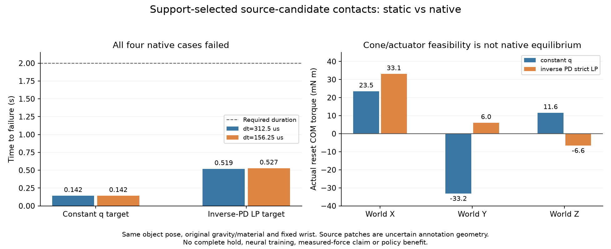

# 重力反事实对照与六维支持条件化接触选择

2026-11-08。上一轮`cb1933d`建立匹配源候选区域的接触，但原生六维射线锥缺少
力矩支持。本轮在固定几何上比较重力目标、枚举候选三指组合并执行机器人适配。
得到一个同时通过静态几何、实际源候选区域匹配和六维/驱动力约束的姿态；其
4个原生持握案例仍全部失败。没有新神经训练或检查点，Goal保持active。

## 重力不是本次失败的唯一解释

保持机器人根、物体位姿、原condim3材料/质量/惯量、求解器和接触几何不变。
将条件源世界Z-up重力经过源物体BODY轴映射到本次物体姿态，只作为LP的另一个
目标。仿真器的实际重力不变；Z-up仍是未经本序列标定的假设，不是新任务执行。

本次两种重力方向相差129.574°。源30点全候选和21点非负局部面偏移候选分别
构造法线-only、4边及8边Coulomb候选包络。在两种重力下，6种包络都能找到六维
静态解；原有3个预紧姿态的实际原生接触锥却在两种重力下均不能六维平衡。
当前重力下这3个原生锥可以只平衡力，条件源重力下连力平衡也未找到。

因此不能仅靠旋转重力来解释或解决当前构型。源包络仍极为乐观：可以同时使用
同指多个未知接触点、无限法向力，无手部几何或驱动约束。其可行不等于人体或
机器人能实现。共36次可行性LP、6次六维分离LP，仿真重力/资产字节保持。

候选包络使用**单位法向力**，切向锥相位固定在BODY轴的Frisvad切平面，然后
整体旋转力和移动COM力矩；不从旋转后的法线重新定相位。力矩不在数据中缩放，
求解时才除0.1 m。它与CHORD单位欧氏力描述子的数值、以及原生接触的切向相位
不同，不能混为同一力预算。4/8边差异是候选锥敏感性，不改仿真接触模型。

## 支持条件化选择，而非只找最近区域

每个候选组三指各取一点，全30点产生8×8×14=896种，21点产生3×6×12=216种。
每种分别测试4/8边锥与两个重力目标，要求三个假设法向系数总和分别至少0.1 N，
以最小总法向系数求解。共4448次LP，不是4448次物理试验。

|源候选集|4边锥：当前重力可行|4边锥：条件源重力可行|8边锥：当前 / 条件源可行|
|---|---:|---:|---:|
|30点|130/896|147/896|134 / 155|
|21点|28/216|41/216|30 / 45|

当前重力的最小假设总法向系数分别为13.042/13.265 N，条件源重力为6.511/6.631 N。
这些是假设锥的下界解，未经驱动、柔度或实际接触验证，不能当作测得的握力。
每个源集固定选“最小法向系数”和“最低原材料锚点几何变化”的两个不同组合，
共4个提议。没有扩大候选区域、增加摩擦或事后只保留较好分支。

## 机器人适配与实际接触检查

对每个精确选定的三点/法线，复用9个手表面锚点、两个合法起点，进行72次逐指
局部拟合，再做4次20关节全手联合避碰。物体位姿与机器人根保持不变。仅几何与
材料点门合格者再做-50 µm的小幅指定组件对预紧，并重新检查全部3025对。

|提议|源点索引（拇/食/中）|最终几何|实际三指候选区域匹配|原生六维支持|
|---|---|---|---|---|
|30点、最小法向系数|0 / 13 / 29|通过|通过|通过|
|30点、低几何变化|5 / 8 / 28|失败|失败|未验收|
|21点、最小法向系数|0 / 8 / 29|通过|通过|未找到|
|21点、低几何变化|6 / 8 / 26|失败|失败|未验收|

两个低变化提议的拇指材料点仍距目标约13.0/10.6 mm，不能因源锥可行就接受。
原生支持合格的提议使用源点13，其局部皮肤—面法向偏移约-0.389 mm；该点属于
有不确定性的30点分支。不能把这个结果称为真实接触标签验证，更不能忽略21点
分支的原生支持失败。负局部偏移也不是全局实体穿透证明。

提议0实际三指法向力约[1.256,2.216,0.997] N；原生几何和接触Jacobian构造的
六维锥与严格完整合法命令域LP均有解。严格域不添加乐观干摩擦盒，最小假设总
法向系数13.901 N。将其关节力矩通过原仿射PD反解成合法目标，不施加任何射线力。
目标相对初始q最大变化0.2615 rad，明确不是旧手机±0.05 rad Actor的同预算对照。

## 静态可行仍未转化为持握

同一新姿态执行恒定q目标与解析PD目标，分别用312.5/156.25 µs两个dt评测：

|控制|粗dt终止|细dt终止|结果|
|---|---:|---:|---|
|恒定q目标|0.142188 s|0.142188 s|转角超过45°|
|严格LP反解PD目标|0.519063 s|0.527188 s|转角超过45°|

共6400次实际积分，4例均未完成2秒，0例通过持握。恒定q还出现约1.16 mrad关节
越界；解析PD没有该项越界。部分端点接近不算完整双dt一致，延后失败不算策略收益。

直接重建reset原生受力，恒定q的净世界力约[-0.824,-0.126,-0.463] N，COM力矩
约[0.02349,-0.03316,0.01155] N·m。解析PD使实际总法向力升至约16.51 N，但净力
仍约[-1.051,-0.630,0.853] N、力矩[0.03306,0.00603,-0.00660] N·m；最大关节
加速度约288 rad/s²。增加总力没有形成原生静态平衡。

这是实测的“射线解/驱动盒解”与实际分配之间的差异。MuJoCo柔性接触求解还依赖
状态、施力和约束参数，不能任意指定锥内接触力后便假定会实现。
[官方接触与约束求解说明](https://mujoco.readthedocs.io/en/stable/computation/index.html#soft-contact-model)

## 验证与后续边界

108项测试通过。保存复核检查27份包络原始解、6份分离证据、710份三点可行解，
重算6份不同的完整几何，直接读取52列原生EFC验证实际扳手/手部负载及2份原始
静态解。4份失败trace的52/52检查通过，reset法向力与trace首次保存值一致。
几何重算复用公共凸体实现，不独立认证全局碰撞谓词；原始解复核不证明所有
不可行状态或最优性。NPZ中的不可行解填充由显式可行mask区分，不是零接触监督。

本轮所有源信息仍来自现成注释/扫描，非独立RGB重建。原始61帧的完整重定向、
序列重力/动力学标定、WM物理梯度与A1/A2收益尚未得到证明。没有新增神经更新
或检查点，也未修改旧手机训练来源/数据角色/驱动/CUDA。

下一步在新六维合格构型上直接检查原生柔度、关节平衡与控制响应，做有界实际
受力/状态投影，再用相同无辅助完整双dt门验证；不能继续把LP状态或更大握力
当作持握。证据和复现入口见`provenance/mug_support_selection/summary.json`及
方案v0.48；本轮工具启动时一次将pin字典直接传给`np.load`的错误在写intent/结果前
修复，未产生实验输出或改变任何输入资产。
