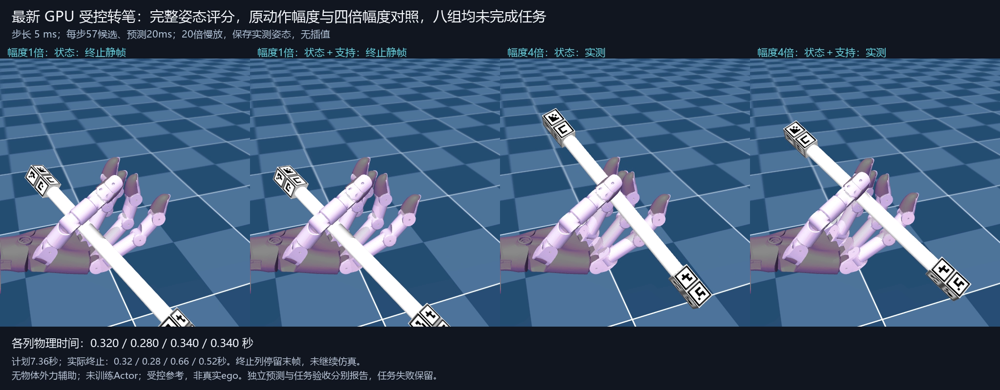

# Wider actions improve this cohort's tracking but remain nonexpert and unqualified

方案v0.84已执行。四倍原始动作偏移在本批四个配对案例中均延长存活时间、
降低 COM 与完整姿态 RMS；但八组仍全部未完成原7.36秒任务。扩大动作范围
同时暴露12次预测门槛失败、一项实际动量检查失败和一组穿透超限，不能
晋升为专家、合格接触监督或稳定策略。完整目标保持 ACTIVE，无神经/Actor更新。

## 固定物理、候选数和预测时长的实际对照

共享运行代码14584ce。原368×57×20偏移表按固定种子8101生成，X4严格等于
X1的四倍，零偏移候选相同。轴偏移从±0.08变为±0.32原始动作；不是新增
随机采样。其余原参考、初始姿态、FULL_SO3/5deg评分、COM/手/残差/支持权重、
CCD50/1e-6、约束数值策略、57候选、20ms窗口和50Hz控制不变。
两个步长、状态/状态＋支持、幅度1/4倍共八个新案例，每格仅一次运行。

|幅度|步长|目标|持续秒|COM RMS mm|完整姿态 RMS deg|
|---|---:|---|---:|---:|---:|
|X1|5ms|状态|0.32|21.781|65.007|
|X1|5ms|状态＋支持|0.28|22.758|67.253|
|X1|2.5ms|状态|0.36|21.462|64.867|
|X1|2.5ms|状态＋支持|0.34|20.337|61.126|
|X4|5ms|状态|0.66|18.656|42.763|
|X4|5ms|状态＋支持|0.52|19.286|24.996|
|X4|2.5ms|状态|0.60|16.562|26.094|
|X4|2.5ms|状态＋支持|0.64|18.413|41.887|

所有案例仍先触发原生物体位置误差终止，COM RMS5/max10mm、完整姿态
RMS5/max10deg和完整时长均失败。X4粗步长支持组最大穿透2.4786mm，超过
原2mm门槛，并有3次所有候选均不满足原几何约束而使用既定最小违规回退；
失败没有被隐藏。其余七组穿透以及所有自穿透、关节、非手力、有限值、
容量、无辅助检查通过。没有中途重置、物体外力、重力/腕部帮助。

这些单次开发案例支持“本批更宽动作范围有跟踪改善”，不能给出统计显著性、
真实 ego 泛化、稳定转笔或接触支持优于基础状态目标的结论。

## 动作缩放与模型匹配

独立矩阵核对143/143通过：两档活动/安装源码、原始参考、初始qpos/qvel、
完整模型数组/标量相同；配置仅幅度不同。X1候选表与明确指定的前一批冻结
原表逐项相等，X4表逐项四倍，不以新生成表自证相等。
完整原始动作表在运行前检查，最大绝对值分别0.271799/0.511799，均低于1。

原.5动作缩放、.5 EMA、编码器偏置及关节目标限幅保持不变。新增保存实际
上下界/偏置，逐候选独立重算 intended/clamped PD，全部逐决策控制/评分
检查4836/4836通过。本批两档均没有 PD 目标限幅截断；相对零偏移候选的
最大 EMA/PD 偏移约为0.02rad与0.08rad。四倍指原始偏移，不假设所有工况
执行目标总是四倍。零偏移仍含原参考、预加载与 EMA，不是零驱动。

每个进程的实际36项任务导入、本次169数组/8标量 Data 布局、每个源及
57候选预测、完整模型/来源快照均保存，前后校验。历史缺失观测不回填。
213回归测试通过，新增表缩放和原EMA/限幅语义测试；实际 CUDA 数据审核
补充隔离单元测试。未修改安装包、驱动或 CUDA。

## 更宽动作下的动力学限制

|独立审核|X1|X4|
|---|---:|---:|
|保存契约（含全局实际EFC检查）|1726/1726|3181/3182|
|实际EFC/动量|28/28|27/28|
|所选动作预测完整门槛|65/65|109/121|

X4的12次预测均有合力门槛失败，其中9次同时力矩失败；粗步长支持k4还
有手/物体速度门槛失败，最大合力差0.112655N。原状态、合力1e-4N和力矩
1e-5Nm门槛未放宽。X4审核非零退出，报告完整保留。契约少通过的一项
为全局实际EFC标志，和下述动量失败重叠，不能相加当独立错误事件。

实际EFC失败位于X4粗步长状态组：最大线动量残差9.41458e-7N·s，大于
原5e-7N·s门槛。局部力解码、广义合力/力矩仍通过。额外零积分分解48/48
解释检查通过，将原残差精确分为：

`m*(Δv-dt*qacc) + dt*(m*qacc-recorded_total_force) + dt*(recorded_total_force-contact_force-m*g)`。

峰值在第3积分tick（名义源时间15ms，控制k0），三项范数依次约
2.30e-11、9.41520e-7、7.21e-11N·s。对应记录的加速度/合力不闭合量
1.88304e-4N；该步求解器迭代5次，上限50。零COM、平动armature/damping为零、
无外力假设已逐例核对。这定位了记录中不一致的主要项，没有证明求解器
根因，也不能以“已解释”把原动量失败改写为通过。

因此，下阶段先复查相同源下的较宽动作响应与原生力/加速度一致性，
而非继续放大动作或启动长训练；见[方案v0.85](research-plan-v0.85.md)。

## 端点覆盖与计算成本

186个源、10602个候选端点的解释检查930/930通过。至少一个候选同时满足
原端点10mm COM、10deg完整姿态及原几何/有限值/容量约束的源为X1的31/65、
X4的48/121。各配对案例首次没有此类候选的源时刻由X1的0.12–0.18秒
移至X4的0.20–0.28秒。两档后续访问状态已分岔，不能把覆盖比例当相同源
因果比较或全局可行性证明。端点检查也不替代连续时间、RMS或完整时长。

|幅度|候选积分|实际积分|合计|候选CUDA累计秒|案例墙钟累计秒|
|---|---:|---:|---:|---:|---:|
|X1|22800|400|23200|13.047|20.581|
|X4|41724|732|42456|25.397|37.410|
|合计|64524|1132|65656|38.444|57.991|

每决策57候选不等于全程相等成本，X4更长存活消耗更多积分。墙钟只覆盖
案例路径部分成本；不含全部进程启动和来源快照。覆盖、动量分解和渲染均
零积分/零学习，不属于训练加速、实时控制或多轨迹适配成本证明。

## 实际录像与证据

两份录像由保存的实际姿态生成，20倍慢放，无插值/再积分/Actor推理。
四列依次为X1状态、X1支持、X4状态、X4支持，终止列明确停留静帧。
解码帧数、2048×800尺寸及中间/末尾图像已检查。

- [5ms录像](../runs/pen_native_amplitude_video_v1/GPU_pen_AMPLITUDE_matrix_0.005s.mp4)
- [2.5ms录像](../runs/pen_native_amplitude_video_v1/GPU_pen_AMPLITUDE_matrix_0.0025s.mp4)

采集报告在 `runs/pen_native_amplitude_{x1,x4}_v1`，矩阵/覆盖/动量/录像
在同前缀的 `*_matrix_review_v1`、`*_coverage_v1`、`*_momentum_v1`、`*_video_v1`。
独立审核、失败项、测试、来源解析与1400项文件引用核对账本在
`provenance/pen_native_amplitude_results`。矩阵报告 SHA256：
`8fbe2bc66b37f4e6db6d847cffa3ef5e30447a4b1fd6f1c4cd3872ac9864eb5d`。
大型数组/模型/源码快照仍在忽略的 runs，旧失败记录未改写。所有进程结束，
无训练或检查点等待。

学习残差与接触支持同预算A1/A2、世界模型接触/梯度、方块/笔统一评估、
保存恢复、多轨迹总成本、真实ego输入/坐标/资产/动力学与硬件观测/零位/
增益/延迟仍是完整目标要求。本批不是稳定专家、真实ego或加速结论。
