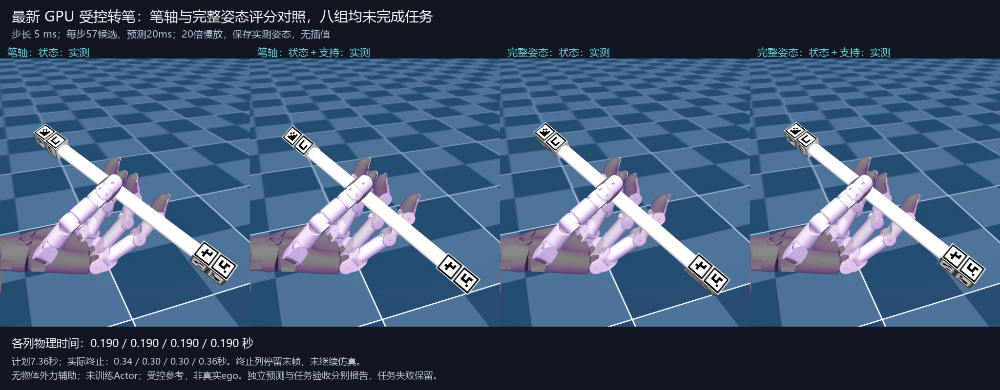

# Full SO(3) scoring changes rankings but does not establish stable pen control

方案v0.83已执行：完整旋转评分、保存候选离线复核、八组新实际控制和
有限候选覆盖检查均完成。完整姿态目标修正了评分遗漏，但本批没有一致的
任务收益，八组仍全部失败。目标保持 ACTIVE；没有神经或 Actor 更新。

## 坐标与评分复核

共享实现增加可选 FULL_SO3，默认 SHAFT 保留原笔轴计算。完整旋转用
归一化相对四元数的 `2*atan2(norm(vector),abs(scalar))`，显式 wxyz、WORLD
姿态，q与-q等价。非法零范数/非有限输入保持非法，不伪造零误差。
角度尺度仍为5deg，其余 COM/手/残差/支持/几何/回退逻辑不变。

211项回归通过，包括128组独立 SciPy 对照、正负号和缩放等价、绕笔轴
180deg时“轴误差零但完整误差pi”、非法输入，以及几何优先和旧评分字节
兼容检查。这是有限动作评分验证，不是学习世界模型接触梯度的验证。

先对上一批全部138个源状态的57个端点离线复核，共7866个候选端点。
检查1006/1006通过：自由物体父节点为WORLD、固定腕、COM原点、参考时钟、
WORLD姿态与 CPU BODY 旋转对应、历史评分/argmin及新角度独立计算。
四元数最大范数偏差约2.19e-7。91/138个状态的新评分选择不同候选。
这不产生新的实际轨迹，也不证明固定腕参考运动全程可行。

## 同物理、同候选数的实际对照

两档均固定原CCD cap50/tolerance1e-6、原约束数值设置、相同初始抓握、
50Hz参考、ZERO_PHYSICAL_EMA、.5/.5控制映射、57候选和20ms预测窗口。
两个步长、状态/状态＋支持、SHAFT/FULL_SO3共八组，每格一个案例。
实际源与模型匹配133/133通过：同一步长/目标的所有模型数组和标量完全
相同，参考、初始qpos/qvel、来源代码和导入记录一致；仅评分模式变化。

|姿态评分|步长|目标|持续秒|COM RMS mm|完整姿态 RMS deg|
|---|---:|---|---:|---:|---:|
|SHAFT|5ms|状态|0.34|19.715|59.776|
|SHAFT|5ms|状态＋支持|0.30|21.304|65.869|
|SHAFT|2.5ms|状态|0.34|19.993|60.006|
|SHAFT|2.5ms|状态＋支持|0.32|21.946|61.501|
|FULL_SO3|5ms|状态|0.30|21.384|64.379|
|FULL_SO3|5ms|状态＋支持|0.36|20.387|60.795|
|FULL_SO3|2.5ms|状态|0.36|19.275|64.713|
|FULL_SO3|2.5ms|状态＋支持|0.32|21.311|63.118|

所有案例都先触发原生物体位置误差终止。完整7.36秒、COM RMS5/max10mm、
完整姿态 RMS5/max10deg均失败；原穿透、自穿透、关节、非手力、无辅助、
有限值和容量检查通过。没有重置续跑、物体外力或成功前缀替代完整任务。
没有一致的完整姿态、接触支持或存活收益，不能由少量单次案例给出泛化
成功率或效果显著性。此前粗/细步长的波动仍保留，不宣称全局确定性。

## 预测正确并不等于控制成功

|独立审核|SHAFT|FULL_SO3|
|---|---:|---:|
|数据/控制/评分契约|1466/1466|1577/1577|
|实际EFC力/动量|28/28|28/28|
|所选动作预测完整门槛|64/65|67/67|

FULL_SO3的67次已选择动作满足原状态、控制、时钟、合力和力矩预测门槛。
这只覆盖这67次短时比较；未选择的候选、其他源、世界模型梯度与完整任务
不随之获得资格。SHAFT在2.5ms状态k1有合力0.000327290N、力矩0.000052735Nm
误差，超过原1e-4N/1e-5Nm，失败报告及非零退出码保留。
FULL_SO3的独立审核退出0表示上述保存数据/预测检查通过，任务仍全部失败。

运行代码5fe3a7e。八组均保存本次观测的169数组/8标量 Data 布局，两个进程
各有36个实际导入任务模块快照，活动/已安装源码前后核对。旧运行中的缺失
导入清单与重建标量没有回填。未修改安装包、驱动/CUDA或历史档案。

## 有限动作覆盖不足的证据与限制

另外检查本批132个已访问源的7524个候选端点，660/660解释检查通过。
仅69/132个源存在至少一个同时满足原端点 COM max10mm、完整姿态 max10deg
以及原几何/有限值/容量约束的候选。SHAFT为34/65，FULL_SO3为35/67。
首个不存在此类候选的源出现在物理时间0.10–0.20秒，按具体案例记录。

在每个案例内，最佳安全候选相对零偏移候选的完整姿态改善中位数约
0.104–0.300deg。零偏移仍执行原参考、EMA与预加载控制，不等于零驱动。
后期有些源即使取候选中的最小完整角误差仍达150deg以上。
因此，仅对这张小幅度、20ms预测的动作表重新评分不能确保维持跟踪。
这并不证明所有机器人动作或参考轨迹在动力学上不可行；这里没有穷尽
控制空间、评估更长时域，也没有对全部未选候选做独立力预测验收。
端点最大误差覆盖检查也不代替 RMS、连续时间或全7.36秒任务检查。

下一步按[方案v0.84](research-plan-v0.84.md)，在原物理和完整姿态评分下，
固定57候选/20ms，只对照原幅度与四倍幅度，检验动作覆盖假设。动作仍通过
原EMA、限幅和几何约束；不改任务门槛，也不据此宣布参考不可行。

## 成本、录像与证据

|评分|候选积分|实际积分|合计|候选CUDA累计秒|案例墙钟累计秒|
|---|---:|---:|---:|---:|---:|
|SHAFT|22344|392|22736|12.946|20.299|
|FULL_SO3|23028|404|23432|13.294|20.841|
|合计|45372|796|46168|26.240|41.140|

存活时长不同导致总积分不同，57候选/决策不是相等全程计算。墙钟包含
案例路径的部分初始化/规划/读回/输出，不覆盖全部进程启动和来源快照。
离线重评分、覆盖复查与渲染增加零物理积分、零神经更新；不属于训练
加速、实时控制或多轨迹适配成本证明。

两份新录像均由保存的实际姿态生成，20倍慢放，没有插值或再次动力学执行。
四列依次为笔轴状态、笔轴支持、完整姿态状态、完整姿态支持；时钟逐列
封顶，终止后标为静帧。已检查解码帧数、2048×800尺寸及中间/末尾图像。

- [5ms录像](../runs/pen_native_orientation_video_v1/GPU_pen_ORIENTATION_matrix_0.005s.mp4)
- [2.5ms录像](../runs/pen_native_orientation_video_v1/GPU_pen_ORIENTATION_matrix_0.0025s.mp4)

报告在 `runs/pen_native_orientation_{shaft,full_so3}_v1`；离线、矩阵、覆盖
和录像报告分别为 `pen_offline_full_orientation_v1`、
`pen_native_orientation_matrix_review_v1`、`pen_native_orientation_coverage_v1`、
`pen_native_orientation_video_v1`。独立审核、源码解析、测试日志和1559个
文件引用的精确核对见 `provenance/pen_native_orientation_results`。
矩阵报告 SHA256：`2e8dbd5604b80ff66931dd3df03e8bb46b9f5e2c1426676c8a4c601461265fb8`。
大型数组、模型与源码快照留在忽略的 runs。当前进程均已结束，无训练或检查点等待。

完整目标中的学习残差/接触支持同预算 A1/A2、世界模型接触/梯度、方块/笔
统一验收、保存恢复、多轨迹总成本、真实 ego 输入/坐标/资产/动力学与硬件
观测/零位/增益/延迟仍为要求。这些有限候选诊断不能替代稳定学习策略和
真实 ego 重定向。Goal ACTIVE/incomplete。
