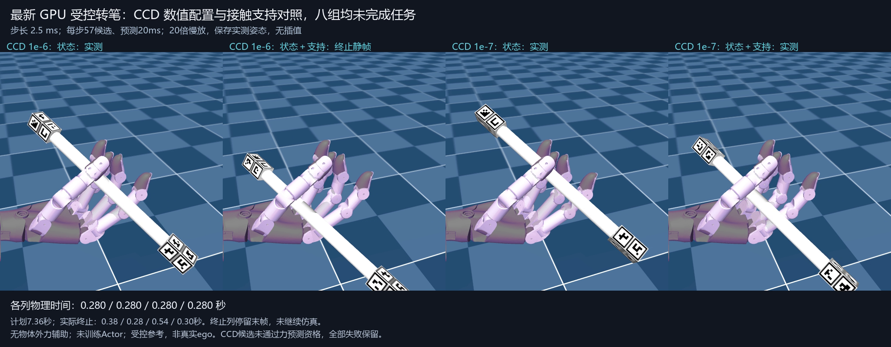

# Fresh CCD control matrix: all eight tasks fail; orientation objective needs correction

方案v0.82的八组新实际闭环试验已执行。收紧 CCD 容差有一组持续时间增加，
但没有一致收益，也没有建立接触支持目标的优势。八组均未完成原7.36秒任务，
全部保留为非专家诊断数据。完整研究目标 ACTIVE，没有新增神经或 Actor 训练。

## 实际结果

|CCD容差|积分步长|控制评分|实际持续秒|COM RMS mm|完整姿态 RMS deg|
|---|---:|---|---:|---:|---:|
|1e-6|5ms|状态|0.34|19.716|59.774|
|1e-6|5ms|状态＋支持|0.30|20.787|64.349|
|1e-6|2.5ms|状态|0.38|19.431|63.045|
|1e-6|2.5ms|状态＋支持|0.28|22.303|65.819|
|1e-7|5ms|状态|0.30|23.452|65.223|
|1e-7|5ms|状态＋支持|0.32|20.347|61.752|
|1e-7|2.5ms|状态|0.54|16.898|52.069|
|1e-7|2.5ms|状态＋支持|0.30|20.165|63.087|

所有案例首先触发原生物体位置误差终止。统一评估的 COM RMS5/max10mm、
完整姿态 RMS5/max10deg 与完整持续时间均失败；穿透2mm、自穿透0.2mm、
关节越界0.001rad、非手法向力0.1N、无外力辅助、有限值及容量检查均通过。
终止后不重置续跑，没有物体外力、等式或重力补偿帮助。
单次案例/单条开发参考不能提供成功率置信区间或真实 ego 泛化结论。

四组数值配置之外，初始状态、物理模型、原50Hz时钟、评分权重、57候选
原始动作表、20ms预测窗口和原控制映射均固定。独立矩阵核对124/124通过，
同一步长/目标的全模型比较只允许 `opt.ccd_tolerance` 数组不同，所有标量
相同。相同候选数/决策不等于全程相同计算预算，存活时间不同必须单独计费。

## 预测与来源的独立审核

|检查|1e-6|1e-7|
|---|---:|---:|
|数据/控制/评分契约|1336/1336|1496/1496|
|实际 EFC 力与动量|28/28|28/28|
|所选动作预测 vs 实际的完整门槛|64/65|70/73|
|本次进程实际导入的任务模块快照|36|36|

138次所选动作比较的状态、控制和时间门槛均通过，但4次合力失败，其中
2次同时力矩失败。基线失败在5ms状态＋支持、k4，合力差0.000109188N。
TIGHT失败在2.5ms状态k3/k17和支持k3，合力差依次为0.000583777、
0.001240786、0.003940232N。原合力1e-4N、力矩1e-5Nm门槛保持不变，
审核返回非零码并完整保存。因此不能把134/138写成物理预测资格已通过。

运行代码220d09c。配置实例的模型构建钩子在创建 GPU 模型与计算图之前
设置 CCD；构建后的 host/device 值再次明确记录与覆盖。本批设备构建时已
得到请求的 float32 容差，后置覆盖没有改变模型字段；不存在用默认容差
进行正式初始化再声称使用候选配置的问题。完整构建/正式模型数组与标量
均保存，之后所有规划使用同一只读模型。

八组都观测记录了本次真实 Data 的169数组、8静态标量及完整布局；容量为
naconmax192、njmax4096。每次源加载检查标量、指针及布局，保存实际源数组、
控制器 EMA/阶段、所有57预测与评分。实际导入清单正常完成，旧运行中
缺失的清单与重建容量没有被回填。活动源码、原生碰撞包源码及 mjlab
模型构建实现均有快照，前后字节检查通过。未修改安装包、驱动或 CUDA。

独立比较代码10aadee；矩阵报告 SHA256：
`14ca31c49821dbd5b41ce9bcb11faaf3dadefdc6874bb5dfec96be16fdee94d4`。
完整回归209项通过，包括新增的实例配置钩子验证；实际 CUDA 运行和独立
保存数据复核补充了隔离单元测试的范围。

## 新录像与完整成本

新录像由这八组保存的实际姿态生成，没有再次积分、Actor推理或姿态插值。
从左到右为：基线状态、基线状态＋支持、TIGHT状态、TIGHT状态＋支持。
20倍慢放；各列物理时钟独立，终止列明确停留末帧。两份视频均校验解码
帧数与2048×800分辨率，并人工检查了中间/末尾图像。

- [2.5ms四列录像](../runs/pen_native_ccd_video_v1/GPU_pen_CCD_matrix_0.0025s.mp4)
- [5ms四列录像](../runs/pen_native_ccd_video_v1/GPU_pen_CCD_matrix_0.005s.mp4)

|配置|候选物理积分|实际控制积分|合计|
|---|---:|---:|---:|
|BASELINE|22344|392|22736|
|TIGHT|26220|460|26680|
|本批总计|48564|852|49416|

候选 CUDA累计约12.836/15.520秒，各案例运行墙钟累计20.144/24.068秒。
墙钟包含本路径的初始化/规划/读回/输出等部分成本，进程启动与来源快照等
并非全部包含。此前保存源对照的20880次积分另行列账，两个阶段总计70296次；
不重复计入本批49416次。此处不是训练加速、实时控制或多轨迹适配成本证明。
所有采集、审核、视频和测试进程已结束，无训练或检查点等待。

## 下一步先修正评分与任务验收的不一致

额外零积分回查比较了实际完整 SO(3) 姿态误差与有向笔轴误差，24/24
一致性检查通过：完整姿态 RMS52.07–65.82deg，而笔轴 RMS5.96–10.41deg。
八组初始完整姿态误差仅约0.00000538deg，未见初始姿态的大偏移。
笔轴角是完整旋转误差的下界，不能将两者的差直接当作精确轴向扭转分解。
它也不能独自排除所有坐标/参考可行性问题。

目前候选评分只惩罚笔轴方向；任务验收使用完整姿态，包含绕笔轴旋转。
因此“轴方向较接近”可能掩盖完整旋转跟踪不足。下一步按
[方案v0.83](research-plan-v0.83.md)，先对保存的全部候选进行完整旋转评分
诊断，再以固定原基线物理设置做完整 SO(3) 目标的同候选预算实际对照。
这是一项有测量依据的目标修正假设，尚未证明会改善 COM、存活或接触力。
原力预测失败继续保留，不启动盲目的长 Actor 训练。

原始报告在 `runs/pen_native_ccd_baseline_v1`、`pen_native_ccd_tight_v1`，
独立审核在同前缀的 `*_review_v1`，矩阵/录像与来源核对见
`provenance/pen_native_ccd_results`。第一份内联姿态探索报告保留，随后由
冻结工具2ae5909在新目录v2重算，原记录不覆盖。大型数据及源码快照仍在忽略的 runs。

完整学习策略与接触支持 A1/A2、公平总预算、世界模型接触/梯度、方块与笔
统一评估、保存恢复、多轨迹总成本、真实 ego 输入/坐标/资产/动力学与
硬件观测/零位/增益/延迟均仍是目标要求。当前结果不是稳定转笔或 ego 重定向成功。
