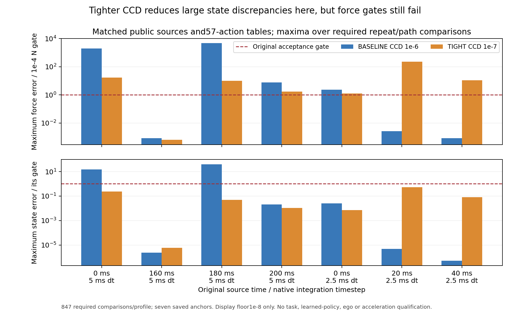

# Matched CCD replay: smaller state discrepancies, force fidelity still unqualified

收紧原生 CCD 碰撞容差在这批保存源状态上明显减小了较大的状态分岔，
但没有通过原定的全部接触力与重复执行门槛。因此保留为开发诊断配置，
不作为可靠世界模型、专家轨迹或稳定转笔的证明。方案 v0.81 已执行；
完整研究目标仍为 ACTIVE。本阶段没有神经网络或 Actor 更新。

## 固定输入、计算预算与来源

正式比较 BASELINE（CCD cap50、tolerance1e-6）和 TIGHT（cap50、1e-7）。
七个保存源锚点不变：5ms 的 STATE_PLUS_VELOCITY_SUPPORT 在0/160/180/200ms；
2.5ms 的 STATE_ONLY 在0/20/40ms。它们来自同一条受控转笔参考，属于开发数据。
每个锚点完整执行57个原始 PD 候选、三次重复，并进行三次独立的插桩执行。
插桩路径固定执行原记录选中的 PD；新重评分选出的索引另行保留，不能替换
配对动作。两档源数组、动作、控制时钟和执行预算的独立核对154/154通过。

每档1197次候选 rollout、6840次候选物理积分与120次插桩积分，共6960次；
正式两档合计13920次。另保留一次增加边界计时之前完成的基线 pilot：6960次。
本阶段总成本20880次原生积分。pilot 不是正式配对基线，也没有被删除或合并
冒充重复样本；增加计时后，正式两档使用完全相同的运行源码。

模型所有字段逐项比较，仅 `opt.ccd_tolerance` 允许变化。几何、材质、质量、
惯量、驱动器、约束求解器、参考、EMA、评分、20ms预测窗口与所有门槛固定。
保存的源数组及布局保持精确；旧 Data 静态容量依然明确标为重建值，
缺失的旧进程导入清单仍不可恢复。源码及已安装碰撞包源码快照保存，
源码全集快照不等于每个模块都曾执行。未修改安装包、驱动或 CUDA。

正式采集代码5cf0947，独立比较代码06d6ea2，绘图代码b91e08f。
单一共享实现位于 `src`；没有为两档再复制研究仓库。

## 完整门槛下的结果

每档必须通过847项比较：所选动作跨执行路径21项、候选所选动作重复14项、
插桩重复14项、全部57候选重复798项。每项同时检查状态、控制、时钟、接触
合力与力矩。下表各行有重叠，不能把通过数相加当独立样本或统计置信度。

|检查|BASELINE|TIGHT|
|---|---:|---:|
|源恢复/只读检查|35/35|35/35|
|保存数据/模型字段检查|399/399|399/399|
|独立 EFC 力与动量检查|147/147|147/147|
|所选动作候选图 vs 插桩图|18/21|18/21|
|候选所选动作重复|14/14|11/14|
|插桩所选动作重复|14/14|14/14|
|全部57候选重复|777/798|779/798|
|847项中任一状态门槛失败数|6|0|
|847项中合力门槛失败数|24|25|
|847项中力矩门槛失败数|16|10|
|全部资格检查通过|否|否|

TIGHT 的全部847项均满足原六项状态门槛，控制与时钟也精确匹配。
这支持“本批较大状态分岔减小”，不支持“接触力预测已可靠”。尤其2.5ms、
20ms源锚点出现新的最大合力差0.0227887N；不能只展示180ms锚点的改善。

|847项中的最大误差|BASELINE|TIGHT|原门槛|
|---|---:|---:|---:|
|手关节位置 rad|0.000311866|0.0000340939|0.002|
|物体位置 m|0.000387357|0.00000472847|0.0005|
|物体旋转 rad|0.0397002|0.000325939|0.01|
|手关节速度 rad/s|0.0623721|0.0135715|0.2|
|物体速度 m/s|0.0774690|0.00189270|0.01|
|物体角速度 rad/s|7.94012|0.105033|0.2|
|接触合力 N|0.464814|0.0227887|0.0001|
|接触力矩 Nm|0.0148730|0.000371674|0.00001|

各列最大值可来自不同动作/比较。TIGHT 在200ms锚点还存在0.0001000796N、
在细步长0ms锚点存在0.0001283110N的所选动作跨路径差异；即使接近门槛也
保留为失败，没有四舍五入通过或放宽门槛。180ms锚点的新重评分索引由基线
2/2/2变为53/53/53，这是数值响应与动作排序变化，不是策略成功。

红线为各自原门槛，纵轴为对数。下图状态比例取六项状态误差比例的最大值，
不是混合精度分数；图中的1e-8显示下限不改变报告数据。

TIGHT 对旧数值模型实际/预测记录的四类比较均为0/21。这些明确标为
OLD_NUMERICAL_MODEL_RESPONSE_DIFFERENCE，表示数值模型变化后的响应不同，
不是同模型预测错误，也不纳入新配置资格。旧失败记录未被修复或覆盖。
两份正式独立 review 因资格失败返回非零退出码，报告完整保存。

## 计时与适用边界

|配置|积分步长|搜索次数|候选 CUDA 均值 ms|提交及等待墙钟 ms|读回及主机复制 ms|
|---|---:|---:|---:|---:|---:|
|BASELINE|5ms|12|175.948|181.115|0.508|
|BASELINE|2.5ms|9|353.938|354.130|0.580|
|TIGHT|5ms|12|178.902|184.092|0.521|
|TIGHT|2.5ms|9|364.724|364.916|0.526|

边界计时在既有同步处测量，没有新增候选内部同步。模型恢复及快照每组约
0.305–0.321秒；图构建（含编译）粗步长约0.905/0.922秒，细步长约0.053秒。
两档 collector 主体墙钟10.826/10.936秒，不含进程启动和最终报告写入。
读回列只覆盖搜索数组复制，不包括全部来源审核、文件输出或插桩逐步读回。
这些是诊断路径计时，不能推导持续 GPU 利用率、实时控制、训练加速或
SuperMimic 相对 CHORD 的成本收益。

208项回归测试通过（隔离的单元测试不代替实际 CUDA 采集和动力学审核）。
本阶段进程均已结束，没有训练或检查点等待。原生接触标注不用未验收的独立
GJK/EPA 封装。小批保存源比较不等于真实物理参数标定或未见 ego 泛化。

## 可复查记录与下一步

主要原始报告位于以下仓库内路径，完整路径及 SHA256 见 provenance ledger：

- `runs/pen_visited_ccd_baseline_v1/report.json`：保留的计时前 pilot。
- `runs/pen_visited_ccd_baseline_v2/report.json`：正式基线，SHA256 b0bec288ac64bb72d08d55298da499241d49cfa25f288cb27cdcd7de6f54fd03。
- `runs/pen_visited_ccd_tight_v1/report.json`：正式候选，SHA256 e4bc7b2bbd4bd47b9390c2628f63ebf422e89052fe65721ab36c206476cc5cfe。
- `runs/pen_visited_ccd_comparison_v1/report.json`：154项配对核对，SHA256 1bc79d1450dac239a696b42ac9198ce48830f5fb082087c8e651f4761464f686。
- `provenance/pen_source_ccd_results`：三份独立审核、配对/绘图摘要、208测试日志、来源解析与文件核对账本。大型数组和源码快照留在忽略的 runs。

下一步按[方案v0.82](research-plan-v0.82.md)做新的完整时钟、无辅助实际控制
诊断，显式标注 TIGHT 尚未通过接触力资格；同时保留原基线。固定原有状态/
接触支持目标、57候选、20ms预测和原任务门槛，采集这次真实观测到的 Data
标量、布局与导入清单。不能把旧保存源回放视为新控制任务的成功结果。

完整7.36秒、COM/完整姿态/穿透/关节/非手接触力/无辅助验收不变。
稳定转笔尚未实现，当前视频仍是此前控制试验。共享世界模型的接触与梯度、
公平预算学习策略 A1/A2、方块/笔统一评估、多轨迹总成本、ego 坐标与资产/
动力学、硬件零位/增益/延迟/观测仍是完整目标要求，不被本次数值诊断替代。
