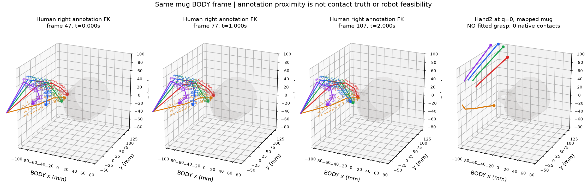
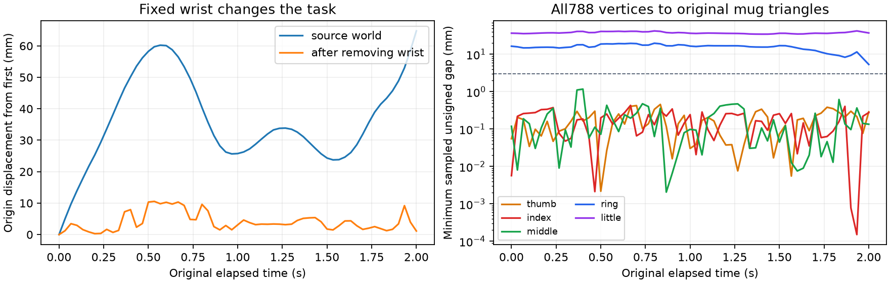

# 右手持杯：人体重建、固定腕参考与 Hand2 场景

2026-11-08。本阶段完成了真实 ego 片段的**已有注释 FK 和坐标契约**，以及带128块
碰撞体的新 Hand2 场景。尚未完成 RGB 独立重建、机器人关节重定向、手指适配、
物理持握或策略训练。前一轮仅核对合仓状态，没有推进研究证据；本轮按 v0.42
执行了新的重建、场景编译、几何查询和保存复核，属于实际进展。

## 输入、人体模型与数值对照

固定使用 HOT3D Aria `clip-001884`，右手，BOP9 杯子实例`223371871635142`，帧47–107。
61个实际时间戳跨度2.000004434 s，相邻间隔31.726227–35.026450 ms。没有补帧、
均匀化时间、拉伸到2秒或重新挑选有利窗口。原 tar 与前次下载清单逐字节哈希一致。

Meta hand_tracking_toolkit 的 UmeTrack FK 固定在
`9064a2fe7fda51bb1f1451a0d3d0da7f3ef5e64e`；两个所需实现文件与上游同版字节一致，
Apache-2.0 声明、LICENSE和来源清单放在`ego/vendor_umetrack`。只通过普通包导入，
没有运行旧 study 的 Python 文件，也没有加载官方完整 viewer 的其他依赖。
见[同版模型实现](https://github.com/facebookresearch/hand_tracking_toolkit/blob/9064a2fe7fda51bb1f1451a0d3d0da7f3ef5e64e/hand_tracking_toolkit/hand_models/umetrack_hand_model.py)。

- 保留全部22角度。该固定 FK 只使用前20个，改变最后2个不会改变输出；这不是
  Hand2 的20维关节映射。原始参数与元数据完整保存在运行目录。
- 人体 profile 位置只在官方`from_json`中由毫米转米一次；`hand_scale=1`没有再乘。
  22根关节轴最大单位长度误差约2.9e-8，未归一化或改写。
- 右手按官方规则反转腕变换第一列，并反转网格三角绕序。这个反射只属于人体
  模型内部；后续人体掌部到机器人掌部使用行列式+1的刚体变换。
- 每帧788个顶点、1544面、21个原始 landmarks；官方 canonical输出为前20个。
- 独立 NumPy FP64 枢轴旋转/链式 FK 对照最大顶点误差6.584e-8 m、landmark误差
  5.510e-8 m；腕部坐标等变对照7.690e-8 m，均低于事前2e-7 m门。
- 原注释有21个“帧×参数”条目超出 profile 声明范围：零基参数3有13条，最多
  0.020857 rad；参数19有8条，最多0.026576 rad。保留原值，没有裁剪。

这些核对验证解析与 FK 一致性，不验证人体估计本身准确、真实接触或机器人可执行性。

## 腕、掌部、BODY 与 COM

人体刚性 rest-palm 约定使用 profile landmarks8/11/14/17，它们与关节 rest pivots
4/8/12/16数值完全相同：原点取四个非拇指基点平均，+X由腕朝基点平均，+Y为
little→index方向去掉X分量，+Z=X×Y。使用右手反射后的静态 profile；不随手指
屈伸重估掌坐标，避免把关节运动误扣为腕运动。这是本项目坐标约定，不是上游
直接提供的 palm 字段，也不等于可变形人体掌面。

机器人采用同样约定，以`right_palm_link`原点作为机器人腕/root锚点，以四个
`right_finger{2..5}_joint1`的q=0轴心为基点。该 root 来自上游`r_wrist`重命名，
名称含palm不代表它位于掌心。人体原点偏移88.8565 mm，机器人66.8069 mm；
只对齐腕旋转会丢失平移，不能作为本任务映射。

对每个原始时间戳：

```
T_sourceWorld_from_humanPalm(t) = T_sourceWorld_from_humanWrist(t) * T_humanWrist_from_restPalm
T_humanPalm_from_objectBODY(t) = inverse(T_sourceWorld_from_humanPalm(t)) * T_sourceWorld_from_objectBODY(t)
T_robotWorld_from_objectBODY(t) = T_robotWorld_from_robotPalm_fixed * T_humanPalm_from_objectBODY(t)
```

不缩放人体或机器人，不直接复制人体角度。保留原始 BOP9 BODY 原点；COM由上轮
显式表面薄壳惯性先验给出，BODY中约[0.1595,46.0089,2.4517] mm，不能当成root。
原生编译后的BODY位姿与COM分别一致，数值误差≤2.3e-16。

|运动量（相对首帧最大值）|位移|转角|
|---|---:|---:|
|杯子原始世界运动|64.765 mm|19.164°|
|人体腕世界运动|68.241 mm|18.829°|
|杯子相对掌部 / 映射后固定腕参考|10.550 mm|3.568°|

在“杯子相对掌部始终保持首帧”的反事实中，仅腕运动造成的物体原点最大位移
65.916 mm。这不是可与相对位移幅值直接相加减的标量分解。固定腕版本改变了
任务定义，不能称为重现了原完整搬运动作。此窗口可用于持握伴小幅相对运动的
探索，不能替代仍待完成的转笔和多轨迹实验。

**源世界重力尚未核实。** 仿真沿用显式[0,0,-9.81] m/s²先验；映射没有证明
保持源重力方向，不能从杯子朝向猜测重力，也不能直接据此生成可信扳手监督。

## 新场景：组合完成，抓握未完成

通过维护中的 Hand2 factory 直接组合 MjSpec，未先转XML再读取机器人。场景为
nq27/nv26/nu20，固定腕、一个自由杯子、无mocap/等式/重力补偿。128个凸块均在
同一个杯子BODY，视觉网格不参与碰撞，质量与完整惯性不因分块重复计算。

21个手碰撞geom加桌面，每块都有显式pair，共2816对；condim3，手滑动摩擦0.7、
桌面0.6、solref[0.002,1]，零margin/gap。均为未标定先验。编译器仍提示父子
spec option冲突及asset-dict附加警告；最终编译求解器参数已显式检查，128块实际
mesh顶点与单体资产一致，机器人碰撞网格、惯性、限位与增益同冻结手机MJB一致。
没有把警告解释为自动解决，后续若再次attach必须重新验证资产完整性。

初态只是**q=0机器人＋首帧掌部映射杯子**，原生forward的手/杯/桌接触数为0。
这不是抓握，也不能仅凭无contact宣称全局无穿透。没有积分、掉落实验、PD闭合、
IK或保持测试。新布局有独立artifact索引，不能复用手机Actor/WM/归一化器。

## 表面接近与手指意图候选

所有61×788=48,068个人体顶点都查询到原杯子31,606个三角面，使用缓存顶点和
面质心KD树给出保守候选集，再计算精确三角最近点。共33,924,939次三角投影；
穷举对应1,519,237,208次。75个预定跨帧样本与原穷举实现的距离差为0。整个
CPU查询和复核约8.95 s；这不是GPU训练性能或政策收益基准。

按最大 LBS 权重分组，仅为几何采样分组，不是语义接触分割：

|分组|每帧最小无符号间隙中位数|存在≤3 mm样本的帧数|
|---|---:|---:|
|拇指|0.161 mm|61/61|
|食指|0.177 mm|61/61|
|中指|0.112 mm|61/61|
|无名指|16.045 mm|0/61|
|小指|36.985 mm|0/61|

前三指每帧都有距离≤3 mm且最近点BODY x<−45 mm的样本，支持杯柄外侧三指
接近的候选解释。该x条件不覆盖整个杯柄，也不是完整语义mask。无符号近距离
不区分皮肤穿入、贴合或估计误差；没有连续面碰撞证书、材料内外符号或真实力标签。
Hand2末端实际碰撞体尺寸也已导出，但**没有证明它们能进入杯柄或提供所需扳手**。





## 验证、失败记录与下一步

最终坐标/场景检查15/15，独立保存复核15/15，全库81项单测通过。v1的位置索引
比较错误、v2未命名visual geom查找错误，以及v3打印numpy.bool的序列化错误均保留
终态及执行源码；v3数值产物已成功保存，但进程exit1，不当作成功run。最终v4
exit0。没有新神经训练、检查点、仿真积分或CUDA初始化；Goal保持active。

入口和8个显式资产角色见`runs/right_mug_frames_v4/artifacts.toml`；大MJB/NPZ在
ignored runs中，小报告、图和SHA在`provenance/right_mug_frames`。复现命令需换
新的output名称，既有结果不会覆盖：

```powershell
& ..\dex-supermimic-research\.venv\Scripts\python.exe tools\prepare_right_mug_reference.py --pilot-root ..\ego-data-pilot-2026-11-07 --mug-asset runs\mug_asset_validation_v2 --output runs\right_mug_frames_new
& ..\dex-supermimic-research\.venv\Scripts\python.exe tools\inspect_mug_hand_proximity.py --reference runs\right_mug_frames_new --output runs\right_mug_proximity_new
& ..\dex-supermimic-research\.venv\Scripts\python.exe tools\review_right_mug_frames.py --reference runs\right_mug_frames_new --output runs\right_mug_review_new
```

下一步是核实重力来源，建立保持人体三指意图而允许机器人几何差异的IK/抓握
提议与实际碰撞检查。只有在新场景获得无辅助、双步长物理基线并明确接触聚合/
观测/时间插值契约后，才采集新TRAIN干预和独立heldout，再启动匹配预算学习。
完整研究范围与首个健康检查点校验/ETA/暂停约定继续保留，见[方案v0.43](research-plan-v0.43.md)。
